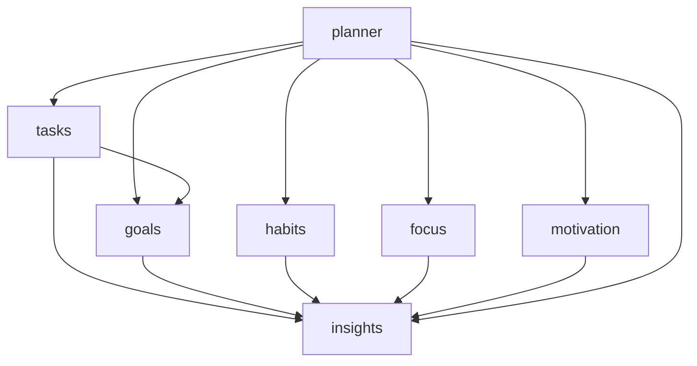

# ADR 0001: Module boundaries and dependency direction

- **Status:** Accepted
- **Date:** 2026-10-14

## Context

The frontend is organised as one module per domain under `src/modules/`
(`tasks`, `goals`, `habits`, `focus`, `planner`, `insights`, ...). Each module
has the same internal shape: `api / components / containers / logic / types`.

Without rules, modules drift into a "big ball of mud": any file can import any
other file, so every internal path becomes de-facto public API and changes
ripple across the repo. Cross-module imports in the codebase already reached
into each other's internals (e.g. `@/modules/goals/api/goals-api`).

## Decision

1. **A module's public API is its `index.ts` barrel.** Other code imports
   `@/modules/<name>`, never `@/modules/<name>/components/...`.
2. **Dependencies flow one way** along a declared layering. Higher layers may
   import lower ones, never the reverse.
3. **No circular imports**, including cycles that pass through a barrel.
4. **Shared, non-domain code stays outside modules** (`components/`, `lib/`,
   `utils/`, `store/`) and must not import from `modules/`.

### Layering

| Layer | Modules | Role |
|---|---|---|
| Composition | `planner` | Assembles other modules into pages (the "Today" view) |
| Domain | `tasks`, `goals`, `habits`, `focus`, `motivation` | Own their data, UI and logic |
| Shared data | `insights` | Types and API consumed by domains |
| Standalone | `identity`, `settings`, `onboarding` | No dependencies on other modules |

The authoritative list is `allowedDependencies` in `eslint.config.mjs`.

## Consequences

**Good**
- Modules can be refactored internally without breaking consumers.
- The dependency graph stays acyclic and reviewable in one place.
- New contributors can see the intended structure from the lint config.

**Costs**
- Anything another module needs must be exported from the barrel first.
- A genuinely new dependency requires a deliberate one-line change to
  `allowedDependencies`.
- Barrels load a whole module, so keep them small and explicit (no
  `export *` of server-only code alongside client components).

## Known open question

`tasks` currently depends on `goals` (task modals fetch goals). Showing a
goal's tasks *inside* a goals component would invert that and create a cycle.
Options: compose from a higher layer (`planner`/route), pass goals into task
modals as props, or extract the shared goal lookup into a lower module.
Unresolved; decide when the feature is built.
