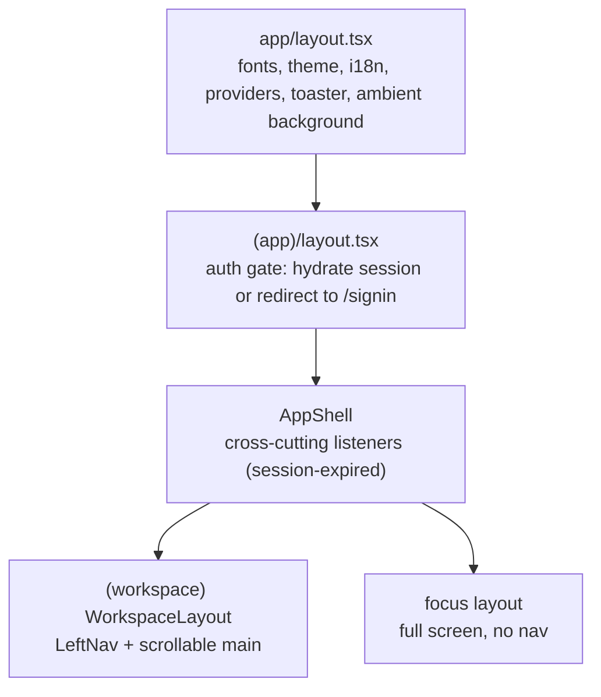

# ADR 0005: App shell

- **Status:** Accepted (recorded retroactively, 2026-10-14)

## Decision

Authenticated routes sit inside **nested layouts, each with one job**:

| Layer | File | Responsibility |
|---|---|---|
| Root | `app/layout.tsx` | `<html>`, Geist fonts, anti-flash theme script, `NextIntlClientProvider`, `ThemeProvider`, `Providers`, `Toaster` |
| Auth gate | `app/(app)/layout.tsx` | Blocks children until the session is hydrated, so pages never call the API without a token |
| `AppShell` | `shared/components/app-shell.tsx` | Behaviour only: listens for `session-expired`, clears auth, redirects |
| Chrome | `shared/components/workspace-layout.tsx` | Left nav + content column (`max-w-6xl`) |

`AppShell` is the **designated home for authenticated, cross-cutting concerns**:
realtime provider, command palette, auth-scoped analytics (listed as planned in
its header comment).

## Consequences

- New global behaviour goes in `AppShell`, not into individual layouts.
- Pages without a sidebar opt out by living outside `(workspace)`.

## Known gaps

- Two places redirect to `/signin` (gate and `AppShell` listener); they could
  drift.
- The gate is client-only (ADR 0003).
- The name `AppShell` (behaviour) vs `WorkspaceLayout` (visual chrome) splits
  what is often one concept.
