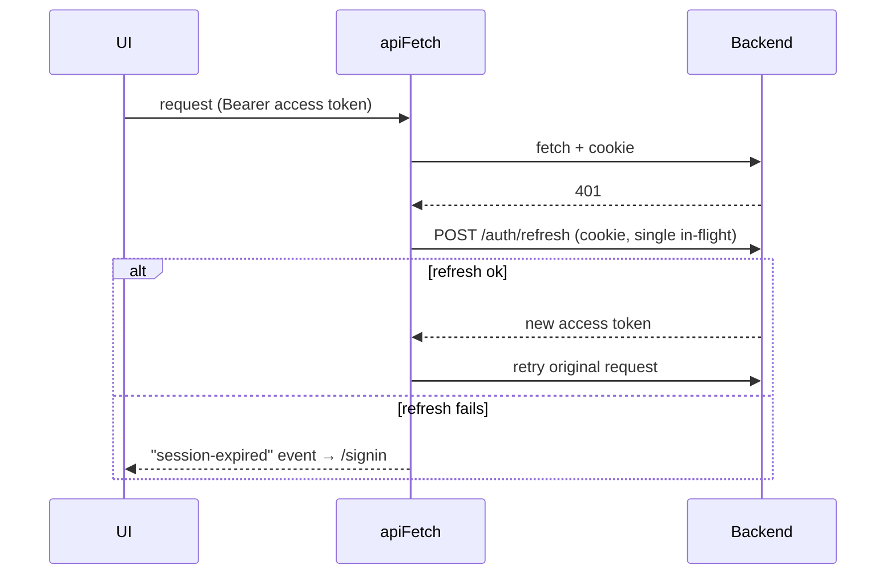

# ADR 0007: Authentication and session handling

- **Status:** Accepted (recorded retroactively, 2026-10-14)

## Context

Stated in `src/shared/lib/api.ts`: tokens must not be readable from persistent browser
storage.

## Decision

- **Access token lives in memory only** (a module variable). It is never put in
  `localStorage` or `sessionStorage`.
- **Refresh token is an HttpOnly cookie** set by the backend; JS never reads
  it. Every request sends `credentials: "include"`.
- **Silent refresh on 401**, behind a singleton promise so concurrent 401s
  trigger exactly one refresh. The original request is retried once.
- If refresh fails, `apiFetch` dispatches a **`session-expired`** event;
  `AppShell` clears state and redirects to `/signin`.
- **OAuth (Google, GitHub) uses PKCE**; callback pages exchange the code.
- Session state is a **zustand store** (`shared/store/auth-store.ts`) with `hydrate`
  (refresh on page load), `clearAuth`, `signoutAll`.

## Consequences

- XSS cannot steal a long-lived credential from storage.
- A page reload loses the access token; it must be re-obtained via refresh
  before any API call (hence the auth gate, ADR 0005).

## Known gaps

- `AuthTokens` / `AuthResponse` types in `src/shared/types/index.ts` still declare
  `refreshToken`, which never reaches JS (tracked in `src/CLAUDE.md`).
