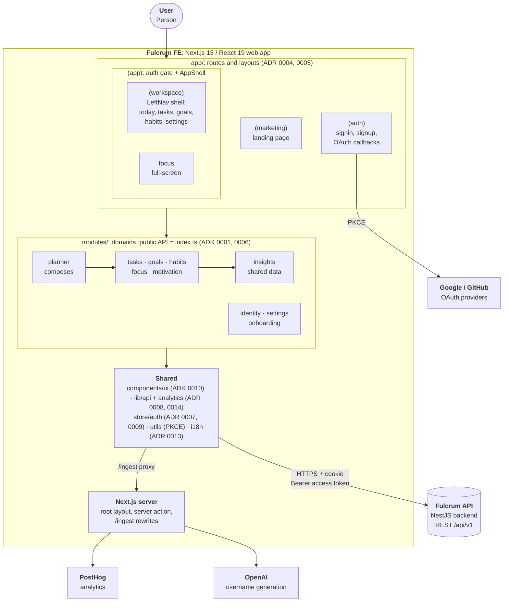

# Architecture Decision Records

Start here. This page shows **how the app is put together** (one diagram) and
**why** (the records below).

Each record is short and numbered. Records are not rewritten: if a decision
changes, add a new ADR and mark the old one `Superseded`.

## System map

A single C4-style view: the system, the containers it runs as, and the
components inside the web app.

How to read it: dependencies point **down and right**. `modules/` may import
shared code, never the other way round, and modules follow the layering in
ADR 0001.

## Decisions

### Architecture

| # | Decision | Status |
|---|---|---|
| [0001](./0001-module-boundaries.md) | Module boundaries and dependency direction | Accepted |
| [0002](./0002-enforcing-boundaries-with-eslint.md) | Enforce boundaries with ESLint | Accepted |
| [0006](./0006-folder-structure.md) | Folder structure and module anatomy | Accepted (retroactive) |

### Platform

| # | Decision | Status |
|---|---|---|
| [0003](./0003-framework-and-rendering.md) | Framework and rendering model | Accepted (retroactive) |
| [0004](./0004-route-structure.md) | Route structure and layouts | Accepted (retroactive) |
| [0005](./0005-app-shell.md) | App shell | Accepted (retroactive) |
| [0007](./0007-auth-and-session.md) | Authentication and session handling | Accepted (retroactive) |
| [0008](./0008-api-client-and-data-fetching.md) | API client and data fetching | Accepted (retroactive) |
| [0009](./0009-state-management.md) | State management | Accepted (retroactive) |

### UI

| # | Decision | Status |
|---|---|---|
| [0010](./0010-ui-component-system.md) | UI component system | Accepted (retroactive) |
| [0011](./0011-theming-and-styling.md) | Theming and styling | Accepted (retroactive) |
| [0012](./0012-forms-and-validation.md) | Forms and validation | Accepted (retroactive) |

### Cross-cutting

| # | Decision | Status |
|---|---|---|
| [0013](./0013-internationalization.md) | Internationalization | Accepted (retroactive) |
| [0014](./0014-analytics.md) | Analytics and error tracking | Accepted (retroactive) |
| [0015](./0015-realtime.md) | Realtime updates | Proposed |

## About "retroactive"

Records marked **Accepted (retroactive)** document decisions that were already
in the code when these ADRs were written (2026-10-14). They state *what* is done
and the evidence in the code. Where the original *reasoning* was not written
down, the record says so instead of inventing one; owners should fill those in.
Each record has a **Known gaps** section listing discrepancies found while
writing it.

## Adding a record

Copy an existing ADR, take the next number, and keep it to **Context**,
**Decision**, **Consequences**. Add a row to the right table above, and update
the diagram if the structure changed.
